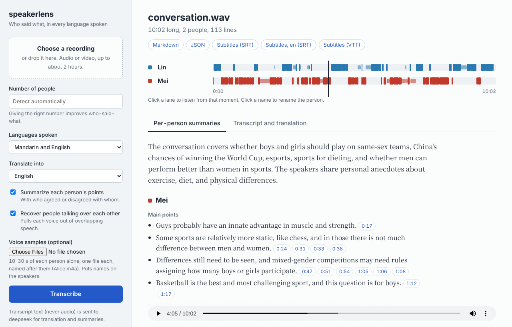

# speakerlens

Turn a multi-person, multi-language recording into a transcript that says **who said what**,
translated, with a **separate summary of each person's perspective**.

Most speech-to-text tools give you one block of text, so a summary blends everyone's views
together. speakerlens keeps speakers apart, handles mixed Mandarin–English speech, and
cites the exact turns behind every summary point.

> Status: v0.2. Tested on benchmark data and a first pair of real recordings (see Results).

## How it works

1. **Diarization** (pyannote community-1): finds who spoke when and flags overlaps.
2. **Speaker check**: regroups turns by voice and moves turns that clearly sound like
   someone else, fixing many of diarization's mix-ups.
3. **Voice enrollment** (optional): names speakers from short voice samples.
4. **Overlapping speech**: when people talk at the same time, each person's voice is pulled
   out of the mix (target speaker extraction, WeSep) using a sample of their voice taken
   from moments they speak alone, and recognized on its own. This includes people talking
   under someone else, who would otherwise be lost.
5. **Language ID + router**: detects each turn's language (only among the ones you pick),
   using each speaker's usual language as a hint, and sends the turn to a language plugin.
6. **Language plugins**: on a GPU, Fun-ASR-Nano for Mandarin, English and mixed speech, with
   SenseVoice as a backup when Nano stops early, loops or answers in another language;
   without a GPU, SenseVoice and Whisper. Whisper covers other languages. New languages can
   be added as plugins.
7. **Calibration**: maps a plugin's confidence to a probability, so the router can compare
   two plugins on an uncertain turn. Fun-ASR-Nano and SenseVoice report no confidence, so
   in the default GPU setup this step rarely changes anything.
8. **Translation and per-speaker summaries** with an LLM (DeepSeek, or Ollama locally).
   Summary points must cite their turns; points citing someone else's words are rejected.

## Example

A 10-minute Mandarin–English conversation between two people from
[ASCEND](https://huggingface.co/datasets/CAiRE/ASCEND) (CC-BY-SA-4.0), run with default
settings: `speakerlens transcribe conversation.wav --lang zh --lang en --translate-to en
--speakers 2`. An excerpt of the Markdown output (`…` marks left-out lines); the full output
covers every topic and also comes as JSON and as subtitles in both languages:

```markdown
### SPEAKER_01

**Main points**
- Some people say that for diet maybe seventy percent is controlling what or how much you eat, and the other thirty percent is exercising more. [00:04:48, 00:04:56, 00:05:01, 00:05:04]
- They can't resist eating, especially at dinner, and love high-sugar, high-calorie things like McDonald's. [00:05:15, 00:05:15, 00:05:17]
…

### SPEAKER_00

**Main points**
- Said besides sports, diet is more important, because if you do a lot of sport and then eat a lot, it's not very useful, so you need to balance everything. [00:04:12, 00:04:35, 00:04:42]
…

**Agreed with**
- Agreed that they also love sweet things and can't resist them. (with SPEAKER_01) [00:05:25]
…

## Transcript
…
**SPEAKER_00** [00:04:35] `en+zh`
因为其实如果你做了很多 sport 然后你就回去吃很多东西的话，其实也没有太大的用。
> Because actually if you do a lot of sport and then you go back and eat a lot of things, it's actually not very useful.

**SPEAKER_00** [00:04:42] `en+zh`
所以感觉可能各方面都要吧，就各方面都要平衡一下。
> So it feels like maybe you need everything, you need to balance everything.

**SPEAKER_01** [00:04:48] `en+zh`
确实，但他们就是有有人讲说说for diet maybe seventy percent is。
> Indeed, but some people say that for diet maybe seventy percent is.

**SPEAKER_01** [00:04:56] `en+zh`
To control your what do you eat or how much you eat.
…
**SPEAKER_01** [00:05:17] `en+zh`
对，我就是很喜欢，我特尤其是晚饭，特别喜欢那种高糖高热量的东西，比如说麦当劳这种东西。
> Right, I really like it, especially at dinner, I especially love those high-sugar, high-calorie things, like McDonald's and stuff.

**SPEAKER_00** [00:05:25] `en+zh` _(overlap)_
对，我也是因为我本身就很喜欢吃甜的东西嘛，然后就可能偶尔会忍不住吃一些很甜的东西，然后就哎感觉感觉就是来了三个之后又变胖了。
> Yeah, me too, because I've always loved sweet things, so occasionally I can't resist eating something really sweet, and then, ugh, it feels like after three of them I've gotten fat again.
```

## Results

Measured on [ASCEND](https://huggingface.co/datasets/CAiRE/ASCEND) (spontaneous
Mandarin–English code-switching speech, CC-BY-SA-4.0), with the number of speakers given.
Lower is better. Errors are counted per Chinese character or English word.

| | Conversations (9, dev) | Meetings (8, simulated, 4 people, dev) | Conversations (2, held out) |
| --- | --- | --- | --- |
| tcpWER, first version, number of speakers not given | 0.296 | 0.346 | 0.227 |
| tcpWER, first version, number of speakers given | 0.223 | 0.316 | – |
| **tcpWER, now** | **0.174** | **0.244** | **0.179** |
| tcORC-WER (words only, any speaker) | 0.149 | 0.133 | 0.145 |
| DER (who spoke when) | 0.137 | 0.168 | 0.119 |
| tcpWER with voice samples | 0.176 | **0.199** | 0.181 |

- **tcpWER** (the CHiME-8 metric) counts a word wrong if it's misheard *or* credited to the
  wrong person (5 s collar). **tcORC-WER** ignores who said it, so the gap between them is
  the speaker-attribution error.
- Voice samples (15–30 s per person, from clips *not* in the test file) help most in
  meetings; with two people the system already tells voices apart, so they change little.
  The samples come from the same recording session, so this is a best case.
- Every setting was chosen on the dev sets; the held-out conversations were scored only to
  check the choices carry over. The meetings are simulated from separate recordings, so
  they have little real overlap and each speaker has their own microphone. Two of the ten
  dev meetings had the same person under two labels (a bug in building them, since fixed)
  and are left out of every number.
  [docs/architecture.md](docs/architecture.md) says what each step contributed;
  [bench/](bench/README.md) has the scripts to reproduce the numbers.

**Real meetings with overlapping speech.** [AliMeeting](https://www.openslr.org/119/)
(Mandarin, 2–4 people in a real room, one distant microphone, CC-BY-SA-4.0; 25–65% of
speech overlapped in 4-person meetings). Development choices (extraction settings, the
fine-tuned model snapshot, summary instructions) were made on Eval; Test was not used for
any choice.

| | Eval (8 meetings) | Test (20 meetings) |
| --- | --- | --- |
| tcpWER, one speaker per moment | 0.303 | 0.299 |
| **tcpWER, now** (+ speaker extraction) | **0.278** | **0.288** |
| DER, one speaker per moment | 0.273 | 0.266 |
| **DER, now** | **0.224** | **0.226** |

Most remaining errors are in heavily overlapped speech: with the true speaker segments
given (Eval), our recognizer gets clean speech 93% right but heavy overlap only 55% (39%
without speaker extraction). Speaker extraction is used only for overlapped speech; on
ASCEND (little overlap) results are unchanged.

An extraction model fine-tuned on AliMeeting's training meetings does a little better
(Eval 0.275, Test 0.281; DER 0.219 on both). It isn't downloaded automatically; get it from
the release (CC-BY-SA-4.0, see its [model card](training/MODEL_CARD.md)) or build it with
[training/](training/README.md), then point `TSE_MODEL` at its folder:

```bash
wget https://github.com/kheleey/speakerlens/releases/download/v0.1.0/tse-alimeeting.tar.gz
mkdir -p models && tar xzf tse-alimeeting.tar.gz -C models
echo "TSE_MODEL=$PWD/models/tse-alimeeting" >> .env
```

**Per-person summaries** (AliMeeting Eval, checked against the human transcript; DeepSeek as
judge, checking who said it and who proposed or agreed):

| | Said by that person | Said by someone else | Said by nobody / twisted |
| --- | --- | --- | --- |
| First summary instructions | 91% | 0.5% | 8% |
| **Now** | **93–95%** | **0–0.5%** | **5–7%** |

Ranges: DeepSeek's summaries vary from run to run. The summary instructions were developed
on these meetings, and the same model writes the summaries, writes the reference summaries
and judges, which may favor it. In a manual check of 30 judged points (marked with an LLM
assistant and reviewed by the author), the judge was right on 85%. Summaries cover about
60% of the points in a summary of the true transcript, against 81–87% for two summaries of
the true transcript itself. Most of what is missing comes from people who talk over others
the whole time, whose words the recognizer gets least of.

**On real recordings** (two 3–4 minute, 3-person Mandarin–English test recordings on one
phone, no voice samples, checked against what each person was meant to argue):
- A normal discussion, people mostly taking turns: all three people kept apart and labeled
  consistently; each person's summary matched what they argued, including who agreed with
  whose proposal.
- A heated debate with deliberate interruptions: the person who kept talking over others
  lost most of those lines to whoever was already speaking, so their summary came out thin
  and the other person's picked up a point that wasn't theirs. Lines spoken alone, and
  most interruptions by the other two, came out right.
- The most common mistake everywhere: English words inside Mandarin sentences (hiking →
  "fighting", intern → "Intel"). It rarely changed the meaning of a summary.

### Compared with other open-source tools

[WhisperX](https://github.com/m-bain/whisperX) 3.8 (Whisper large-v3 with the same
pyannote diarizer speakerlens starts from) and Microsoft's
[VibeVoice-ASR](https://huggingface.co/microsoft/VibeVoice-ASR) (one 8.7B model for words
and speakers) on the same files, scored by the same scripts. Each runs as a typical user
would run it: no word lists or other hints, the true number of speakers given wherever the
tool accepts it, speakerlens with its default extraction model. VibeVoice-ASR has no option
for the number of speakers, so speakerlens is also shown without it. WhisperX's rows split
its segments wherever its per-word speaker labels change, its better result. Lower is
better; DER in brackets leaves out the stretches where several people talk at once, since
VibeVoice-ASR and WhisperX write one speaker at a time.

**Held-out sets** (never used for any choice):

| | AliMeeting Test (20 real meetings): tcpWER | DER | ASCEND conversations (2): tcpWER | DER |
| --- | --- | --- | --- | --- |
| **speakerlens** | **0.288** | **0.226** (**0.092**) | 0.179 | **0.119** (**0.100**) |
| speakerlens, number of speakers not given | 0.305 | 0.238 (0.098) | 0.179 | **0.119** (**0.100**) |
| VibeVoice-ASR | 0.416 | 0.446 (0.269) | **0.115** | **0.119** (**0.100**) |
| WhisperX | 0.441 | 0.341 (0.175) | 0.443 | 0.318 (0.308) |

WhisperX detected Mandarin in every held-out file, so its language-detected and
Mandarin-set runs are the same here.

**Development sets** (settings were chosen on these, which favors speakerlens):

| tcpWER | ASCEND conversations (9) | ASCEND meetings (8, simulated) | AliMeeting Eval (8, real) |
| --- | --- | --- | --- |
| **speakerlens** | 0.174 | 0.244 | **0.278** |
| VibeVoice-ASR | **0.149** | **0.233** | 0.386 |
| WhisperX, language detected | 0.535 | 0.472 | 0.455 |
| WhisperX, Mandarin set | 0.421 | 0.430 | 0.455 |

| DER | ASCEND conversations | ASCEND meetings | AliMeeting Eval |
| --- | --- | --- | --- |
| **speakerlens** | **0.137** (**0.102**) | **0.168** (**0.145**) | **0.224** (**0.091**) |
| VibeVoice-ASR | 0.152 (0.114) | 0.172 (0.146) | 0.376 (0.196) |
| WhisperX, language detected | 0.376 (0.348) | 0.369 (0.353) | 0.344 (0.175) |
| WhisperX, Mandarin set | 0.320 (0.291) | 0.343 (0.326) | 0.344 (0.175) |

**Words recognized, by language** (any speaker; higher is better). ASCEND conversations
(dev), whose words are 63% Mandarin, 28% English and 9% one language inside the other, and
AliMeeting Test, which is all Mandarin:

| | Mandarin | English inside Mandarin | English | Mandarin inside English | AliMeeting Test |
| --- | --- | --- | --- | --- | --- |
| **speakerlens** | **92.9%** | 76.5% | 78.1% | 66.6% | **75.1%** |
| VibeVoice-ASR | **92.9%** | **79.8%** | **82.5%** | **67.4%** | 60.3% |
| WhisperX, language detected | 59.0% | 65.8% | 68.7% | 49.2% | 64.0% |
| WhisperX, Mandarin set | 83.6% | 61.2% | 38.5% | 64.2% | 64.0% |

**Per-person summaries** (held-out AliMeeting Test): each tool's transcript went through
the same summarizer (speakerlens's, with DeepSeek) and the same judge, against summaries of
the human transcript:

| | Said by that person | Said by someone else | Said by nobody / twisted | Reference points covered |
| --- | --- | --- | --- | --- |
| **speakerlens** | **95.3%** | 1.3% | **3.4%** | 66.1% |
| VibeVoice-ASR | 94.2% | **1.1%** | 4.7% | **67.2%** |
| WhisperX | 90.5% | 5.0% | 4.5% | 64.5% |

What this shows:
- **Overlapping speech**, what speakerlens is built for: in real meetings it is clearly
  best, on the held-out AliMeeting Test (tcpWER 0.288 against 0.416–0.441, DER 0.226
  against 0.341–0.446) as on Eval, and also when it isn't told the number of speakers
  (0.305). Even leaving out the overlapped stretches, its speaker turns are the most
  accurate (DER 0.092 against 0.175–0.269).
- **Summaries** forgive most word errors: a person's summary needs their main points, not
  every word. From speakerlens's and VibeVoice-ASR's transcripts they come out about the
  same (differences of about a point are within DeepSeek's run-to-run variation, and the
  judge is the same model). From WhisperX's, about four times as many points go to the wrong
  person.
- **Clean code-switching speech**: VibeVoice-ASR gets more words right, mostly English
  (82.5% of English words against 78.1%, 84.9% against 80.5% on the held-out
  conversations). That gives it the best tcpWER on the ASCEND conversations (held out 0.115
  against 0.179) and the simulated meetings (0.233 against 0.244). Who spoke when is close
  there (DER 0.119 for both on the held-out conversations). With voice samples, speakerlens
  reaches 0.199 on the simulated meetings; VibeVoice-ASR has no such option.
- **WhisperX** picks one language per file from its first 30 seconds (it took a mostly
  Mandarin dev conversation for English), and with Mandarin set it loses most English
  speech (38.5% recognized). Its own transcript gives one speaker per segment; that scores
  0.570 / 0.540 on the dev conversations, 0.966 / 0.975 on the meetings, 0.623 on the
  held-out conversations, and 0.704 / 0.712 on AliMeeting Eval / Test.
- VibeVoice-ASR's paper reports AliMeeting tcpWER 0.295 and DER 0.109, with settings it
  doesn't fully state; on these single-microphone sets with these scripts we got 0.386 /
  0.416 (Eval / Test) and DER 0.376 / 0.446. It needs about 19 GB of GPU memory (we split it
  across two 24 GB cards); speakerlens runs on one.

Scripts and setup: [bench/compare/](bench/compare/README.md).

## Requirements

- Linux (e.g. Ubuntu 22.04/24.04), Python **3.11 or 3.12**
- ffmpeg: `sudo apt install ffmpeg` (without sudo: `conda install -c conda-forge ffmpeg`)
- Optional: an NVIDIA GPU. Everything also runs on CPU, just slower.
- About 10 GB of disk for models

## Setup

```bash
# 1. Get the code and create a virtual environment
git clone https://github.com/kheleey/speakerlens.git
cd speakerlens
python3 -m venv .venv            # needs python3-venv: sudo apt install python3-venv
source .venv/bin/activate
pip install --upgrade pip

# 2a. NVIDIA GPU: install PyTorch for your driver's CUDA version (nvidia-smi shows it,
#     top right), then everything. For example, for CUDA 12.6 or newer:
pip install torch torchaudio --index-url https://download.pytorch.org/whl/cu126
pip install -e ".[all,dev]"

# 2b. No GPU: install CPU-only PyTorch first (a much smaller download), then everything
pip install torch torchaudio --index-url https://download.pytorch.org/whl/cpu
pip install -e ".[all,dev]"

# 3. Add your keys
cp .env.example .env
nano .env                        # or any editor; see "API keys" below

# 4. Check the setup
speakerlens doctor
```

### API keys: where they go

Put them in the **`.env` file at the project root** (created in step 3). It is git-ignored,
so keys never get committed. Never put keys in Python files.

```bash
# .env
DEEPSEEK_API_KEY=sk-your-key-here     # translation + summaries
HF_TOKEN=hf_your-token-here           # downloading the pyannote model
```

- **DeepSeek key** (optional): get one at <https://platform.deepseek.com/api_keys>.
  Without it, you still get the speaker-labeled transcript, just no translation or summaries.
  Only transcript text is sent to DeepSeek, never audio. The default model is
  `deepseek-flash` with thinking turned off (fast and cheap); see `.env.example` to use
  `deepseek-v4-pro` or turn thinking on for summaries.
- **Hugging Face token** (required for diarization): first accept the model terms at
  <https://huggingface.co/pyannote/speaker-diarization-community-1>, then create a read
  token at <https://huggingface.co/settings/tokens>.
- **Fully local instead of DeepSeek**: install [Ollama](https://ollama.com), run
  `ollama pull qwen3:8b`, and set `LLM_PROVIDER=ollama` in `.env`.

## Usage

```bash
# Mandarin + English meeting, translated to English, with per-speaker summaries
speakerlens transcribe meeting.m4a --lang zh --lang en --translate-to en

# Name the speakers: a folder with one short sample per person (voices/Alice.m4a, ...)
speakerlens transcribe meeting.m4a --voices voices/ --speakers 3

# English only, no summaries, subtitles + JSON
speakerlens transcribe talk.mp4 --lang en --no-summary -f srt -f json

# Any language (slower, less accurate than picking languages)
speakerlens transcribe call.wav --lang auto

speakerlens plugins      # list language plugins
speakerlens licenses     # model licenses and attribution
speakerlens doctor       # check the setup
speakerlens web          # the same in a web page, see below
speakerlens transcribe --help
```

**Options of `speakerlens transcribe`**

| Option | Default | What it does |
| --- | --- | --- |
| `--lang zh --lang en` | `zh`, `en` | Languages spoken; `auto` allows any (slower, less accurate) |
| `--speakers N` | detected | Number of people; or a range with `--min-speakers`, `--max-speakers` |
| `--voices DIR` | none | One voice sample per person, named after them: names the speakers and improves who-said-what |
| `--translate-to en` | off | Translate every turn (needs an LLM) |
| `--summary` / `--no-summary` | on | Per-person summaries (needs an LLM); `--summary-lang` sets their language |
| `--extract` / `--no-extract` | on | Recognize overlapping speech from each person's extracted voice |
| `--reassign-margin` | `0.1` | Speaker check: how clearly a turn must sound like someone else to be moved; `0` turns it off |
| `--asr-profile` | `auto` | Speech models: `nano` (Fun-ASR-Nano, GPU), `routing` (SenseVoice + Whisper), `auto` picks `nano` on a GPU |
| `-o DIR` | `output/` | Output folder |
| `-f md -f json -f srt` | those three | Formats: `md`, `json`, `srt`, `vtt`, `rttm`, `stm` |
| `--no-cache` | cache on | Run diarization again instead of reusing it |
| `-v` | off | Detailed log |

Settings you choose once go in `.env`, each explained in `.env.example`: the LLM
(`LLM_PROVIDER`: DeepSeek, Ollama or none, and its model), `DEVICE`, `ASR_PROFILE`,
`SPEAKER_EXTRACTION`, `TSE_MODEL` (your own or the AliMeeting-tuned extraction model), the
Hugging Face mirror and the cache folder. Command-line options override them.

**Tips for the best results**
- Give `--speakers N` when you know how many people talk.
- For meetings with 3 or more people, give voice samples: 10–30 s of each person speaking
  on their own, one file per person, named after them. They name the speakers *and* fix
  who-said-what (on the simulated benchmark meetings: tcpWER 0.244 → 0.199).
- Overlapping speech is handled automatically: each person's voice is extracted from the
  overlapped parts (the model downloads once, 250 MB; `--no-extract` turns it off).
- If a recording is all Mandarin (or all English), say so: `--lang zh` instead of the
  default Mandarin + English. On AliMeeting Test this lowers tcpWER by about 0.01.
- Record well: a normal furnished room rather than a big bare one, and the phone flat in
  the middle of the table. Nothing done to the audio afterwards makes up for a poor
  recording: removing room echo (WPE) gave no gain with one microphone, so it isn't included.

Outputs go to `output/`: a readable Markdown file with summaries and the transcript,
JSON with every detail, and SRT subtitles (plus a translated SRT when you use `--translate-to`).

### Web page

Prefer a browser to the command line? Start the local web page:

```bash
speakerlens web          # then open http://127.0.0.1:7860
```


<sub>The same [ASCEND](https://huggingface.co/datasets/CAiRE/ASCEND) conversation as the example above (CC-BY-SA-4.0); the names were added with the page's renaming.</sub>

Upload a recording, choose the number of people, the languages and the translation language,
and follow the progress. The result shows who spoke when as one lane per person, each
person's summary, and the transcript with its translation. Click a point's time to jump to the
line it came from, click a line or a lane to listen from there, and click a name to rename
someone; the downloads (Markdown, JSON, subtitles) follow the new names. Recordings are
processed one at a time and kept in `output/web/`, so they're still listed after a restart.
If you leave the number of people empty, the page says how many it found and lets you run the
recording again with a different number; giving the right number helps most when someone keeps
talking over the others.

The page runs on your machine and has no login, so it only listens on this computer by default
and refuses requests made by other websites open in your browser.
On a remote server, open it through VS Code's Ports tab, or run
`ssh -L 7860:localhost:7860 <server>` on your own computer. `--port` and `--out` change the port
and the folder.

## Project layout

```
src/speakerlens/
  types.py            core data: Turn, Speaker, Transcript, Summary
  config.py           settings from .env
  audio.py            ffmpeg loading, slicing
  diarization/        pyannote wrapper, turn building, voice enrollment, speaker check
  extraction.py       target speaker extraction for overlapped speech
  _vendor/            WeSep / WeSpeaker model code (Apache-2.0), kept as published
  plugins/            plugin contract, registry, Fun-ASR-Nano, SenseVoice, Whisper plugins
  textfix.py          repairs for speech-model output (loops, spelled letters, capitals)
  langid.py           language identification
  router.py           which plugin handles each turn
  calibration.py      isotonic calibration and ECE
  llm.py              DeepSeek / Ollama client
  translate.py        per-turn translation
  summarize.py        per-speaker summaries + attribution check
  pipeline.py         runs everything in order
  export.py           Markdown, JSON, SRT/VTT, RTTM, STM
  cli.py              the `speakerlens` command
  web.py, web_page.html  the local web page (`speakerlens web`)
tests/                fast tests with fake models (no downloads needed)
bench/                benchmark scripts behind the README numbers (not installed)
training/             fine-tuning the extraction model on AliMeeting (not installed)
docs/                 architecture and plugin-writing guides
```

## Development

```bash
pytest                 # runs in seconds; uses fake models
ruff check . && ruff format .
mypy src
```

Add a language: see [docs/writing-a-plugin.md](docs/writing-a-plugin.md).

## Troubleshooting

- **Translation or summaries fail**: the transcript is still saved. Check the key with
  `speakerlens doctor`. "HTTP 402" means the DeepSeek account balance is empty. "No model"
  or "refused the request for model" usually means an old model name in `.env` (e.g.
  `deepseek-chat`, retired in July 2026); remove `DEEPSEEK_MODEL` or set it to
  `deepseek-flash`.
- **`Could not load pyannote/...`**: accept the model terms on Hugging Face and check `HF_TOKEN`.
- **`speakerlens doctor` finds no CUDA GPU although you have one**: PyTorch was probably
  built for a newer CUDA than your driver supports. Reinstall it from the index that
  matches your driver (Setup, step 2a).
- **CUDA / cuDNN errors from faster-whisper**: set `DEVICE=cpu` to confirm everything
  else works, then match your CUDA and cuDNN versions to the CTranslate2 requirements.
- **Very slow on CPU**: set `WHISPER_MODEL=small` and `WHISPER_FALLBACK_MODEL=small` in `.env`.
- **Model downloads slow**: set `SENSEVOICE_HUB=ms` (ModelScope) and try `HF_ENDPOINT` in `.env`.
- **"Speaker extraction failed ... using the original audio"**: the transcript is fine,
  but overlapped speech is recognized from the mixed audio. Usually the model hasn't been
  downloaded yet and downloads are off (`HF_HUB_OFFLINE=1`): run once online, or download it
  yourself and set `TSE_MODEL` (see `src/speakerlens/extraction.py`).
- **A run hangs at the start with the GPU idle**: Hugging Face checks for model updates
  online on every load, and that request can hang. Once models are downloaded, run with
  `HF_HUB_OFFLINE=1` (e.g. `HF_HUB_OFFLINE=1 speakerlens transcribe ...`).

## Privacy

Audio is processed on your machine. If you enable DeepSeek, transcript text is sent to
DeepSeek for translation and summaries; use Ollama to keep everything local. Voice samples
and speaker embeddings stay on disk in your cache folder. Get consent before recording people.

## License

Code: Apache-2.0 (see `LICENSE`). Models are downloaded separately under their own licenses:
pyannote community-1 and WeSpeaker embeddings (CC-BY-4.0, attribution required),
Fun-ASR-Nano (Apache-2.0), Whisper (MIT), SenseVoice (FunASR Model License v1.1), WeSep
speaker extraction (code Apache-2.0, bundled in `src/speakerlens/_vendor/`; checkpoint
trained on VoxCeleb1, CC-BY-4.0, attribution required). The optional AliMeeting-tuned
extraction model is CC-BY-SA-4.0. Run `speakerlens licenses` for the full list.
